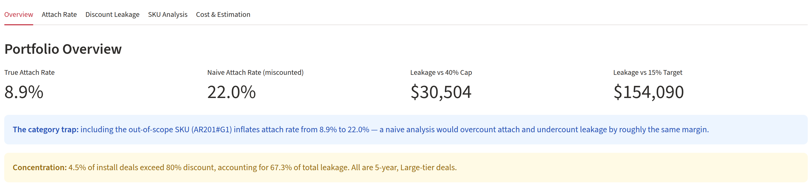
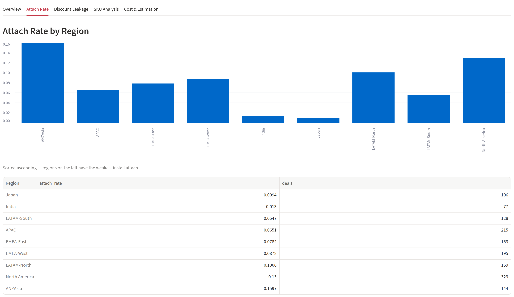

# Install Attach & Discount Leakage Analysis — Case Study
🔗 **[Live App](https://install-attach-discount-case-study-2qcgxrbrgeatjtvvxmngtj.streamlit.app)** — interactive dashboard + AI copilot, running on the same synthetic data as the static case study below.

**A synthetic, fully-fabricated recreation of a real enterprise analysis: reconstructing where a hybrid-cloud software company's installation revenue and margin were actually leaking — and catching two analytical mistakes along the way that would have understated the problem by more than half.**

All company names, product names, SKU codes, regions, partners, and dollar figures below are synthetic, generated to reproduce the *statistical shape* of a real analysis without using any real company's data.

## Screenshots

Screenshots of the Streamlit dashboard in this repository, running on the synthetic dataset from `generate_data.py`. The metrics and charts are computed by `analysis.py`.

*Overview. Figures come from the synthetic dataset.*

*Attach rate by region. Figures come from the synthetic dataset.*

## The scenario

**Solstice Cloud Systems** sells **Aurora**, a hybrid-cloud management platform, through a mix of direct and partner-led channels. Three things are sold together but tracked separately: the software license, an installation/deployment service ("Aurora Professional Services"), and an ongoing support contract ("Aurora Care").

Three business hypotheses needed testing:
1. Customers are skipping the paid installation service and calling Support instead when they hit setup issues.
2. Installation discounting is creeping past the 40% policy cap, and it's unclear where.
3. Some regions barely sell installation at all — is that a real gap or a false signal?

## What this demonstrates

This isn't a "look, I can build a dashboard" project. It's a record of an actual analytical process — including the mistakes caught along the way, which is the part that's hard to fake:

- **A category-label trap.** The Professional Services category contains a SKU (`AR201#G1`) explicitly marked *out of scope* in the product catalog — but a naive analysis that trusts the category label alone would include it anyway, **inflating the measured attach rate from 8.9% to 22%** and understating leakage to match. The fix required going one level below the category label to the actual SKU catalog.
- **A retiring SKU whose behavior didn't retire with it.** `AR210` is marked retired, but continues generating orders into recent quarters before volume abruptly shifts to its replacement, `AR215` — and the replacement inherits a similar discount pattern. Retiring a SKU code doesn't retire the underlying sales behavior; the analysis had to track the *behavior*, not just the *SKU name*.
- **Cap-breach vs. target-average are two different questions.** A "40% discount cap" framing only counts dollars *above* the ceiling — but if the median deal already sits at 40%, that framing hides most of the actual problem. This analysis calculates both, explicitly, so neither number can be mistaken for the other.
- **Extreme-value concentration.** A small share of deals (~4-5%) — overwhelmingly large, 5-year commitments — account for roughly two-thirds of total discount leakage. That's a different, more actionable finding than "average discount is too high."
- **Three independent methods to estimate a number you can't directly observe** (what installation revenue *would have been* on deals that skipped it): a tier-based median, a fitted power-law model (with its R² honestly reported, not hidden), and a simple adjustable percentage — presented side by side rather than picking one and hiding the disagreement.

## Files

| File | What it is |
|---|---|
| `generate_data.py` | Generates the synthetic source data — plants every pattern above deliberately, the same way a real dataset would need to be reverse-engineered from |
| `analyze.py` | Independent Python analysis — computes attach rate, discount leakage, tier medians, and the power-law fit, verifying the patterns before they're built into the workbook |
| `Aurora_Discount_Attach_Model.xlsx` | The finished, fully-live Excel model — 9 tabs, ~6,500 formulas, zero errors, every number traceable back to raw synthetic order data |

## Workbook structure

- **Assumptions** — every lever (discount cap, target average, attach rate target, cost-model tiers, estimation-method parameters) in one place, color-coded (blue = input, yellow = key scenario lever)
- **1. Discount Leakage** — cap-breach and target-average views, side by side
- **2. Attach Rate What-If** — current rate plus a live sensitivity table
- **3. Missed Support Cost Model** — placeholder-tiered cost of skipped-install support calls, explicitly labeled as unverified until real support-case data exists
- **4. Leakage by SKU** — the retiring-SKU migration story, broken out
- **Three raw detail tabs** (Install, Attached, Skipped deals) — fully filterable, with Region/Partner/Seller/Term/ACV/Size-Tier on every row, so any claim in this README can be traced back to the underlying rows

## Methodology notes worth reading before reusing this pattern

- Every hardcoded number is documented with its source in an adjacent cell or comment — no unexplained magic numbers
- Every total is formula-driven off raw detail tabs, not pasted as a static result — change an assumption, everything recalculates
- Estimation methods are presented with their honest limitations (sample sizes, R², "directional not committed") rather than a single confident-sounding number
- Real bugs were caught and fixed during the actual build this is modeled on: a sign-convention error, a dataframe indexing gap, a divide-by-zero — the discipline was catching these *before* shipping, not assuming a clean formula recalculation meant a correct one

## License

This project is released under the [MIT License](LICENSE).
